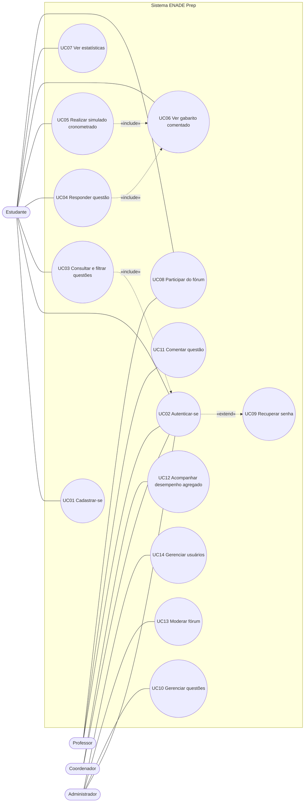
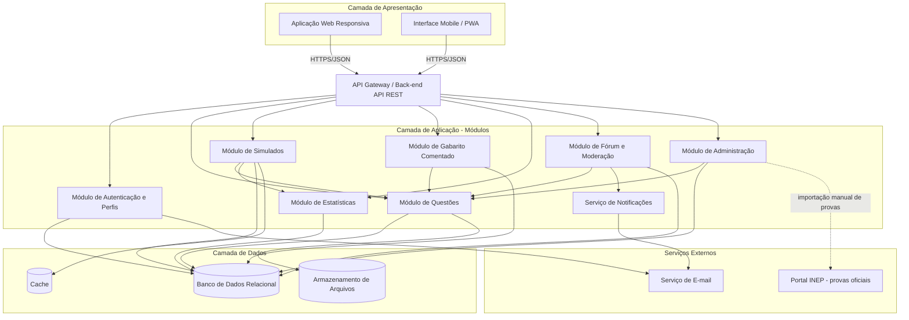
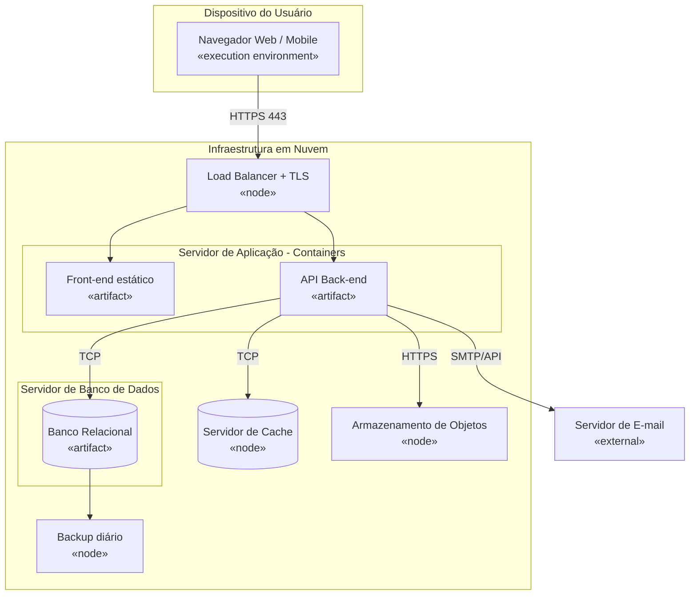

# 7. Modelagem UML

> Os diagramas abaixo usam **Mermaid** e renderizam automaticamente no GitHub. Os arquivos-fonte ficam em `docs/diagramas/`. Para o PDF ou apresentação, podem ser redesenhados no Draw.io, Lucidchart ou Astah seguindo a mesma estrutura.

## 7.1 Diagrama de Casos de Uso

### Atores
| Ator | Descrição |
|------|-----------|
| Estudante | Usuário que estuda, responde questões, faz simulados e participa do fórum |
| Professor | Comenta questões e apoia pedagogicamente |
| Coordenador | Acompanha desempenho agregado do curso |
| Administrador | Gerencia questões, usuários e moderação |

### Casos de uso
| ID | Caso de uso | Ator(es) | Requisitos |
|----|-------------|----------|-----------|
| UC01 | Cadastrar-se | Estudante | RF01 |
| UC02 | Autenticar-se | Todos | RF02, RF04 |
| UC03 | Consultar e filtrar questões | Estudante | RF05, RF06 |
| UC04 | Responder questão | Estudante | RF07 |
| UC05 | Realizar simulado cronometrado | Estudante | RF12–RF15 |
| UC06 | Ver gabarito comentado | Estudante | RF10 |
| UC07 | Ver estatísticas de desempenho | Estudante | RF16, RF17 |
| UC08 | Participar do fórum da questão | Estudante, Professor | RF19, RF20, RF22 |
| UC09 | Recuperar senha | Todos | RF03 |
| UC10 | Gerenciar questões | Administrador | RF09 |
| UC11 | Comentar questão | Professor | RF11 |
| UC12 | Acompanhar desempenho agregado | Coordenador | RF18 |
| UC13 | Moderar fórum | Administrador | RF21 |
| UC14 | Gerenciar usuários | Administrador | RF23 |

### Especificação resumida — UC05 Realizar simulado cronometrado
| Campo | Descrição |
|-------|-----------|
| Ator principal | Estudante |
| Pré-condição | Estudante autenticado |
| Fluxo principal | 1. Estudante escolhe curso, componente e quantidade de questões. 2. Sistema gera o simulado e inicia o cronômetro. 3. Estudante responde as questões. 4. Sistema salva cada resposta automaticamente. 5. Estudante finaliza ou o tempo se esgota. 6. Sistema calcula a nota e exibe resultado e revisão (UC06). |
| Fluxos alternativos | A1. Conexão cai → sistema permite retomar em até 30 min (RN18). A2. Tempo esgota → encerramento automático (RN07). |
| Pós-condição | Resultado registrado nas estatísticas do estudante |
| Regras | RN07, RN08, RN09, RN18 |

## 7.2 Diagrama de Componentes

| Componente | Responsabilidade | Requisitos |
|-----------|------------------|-----------|
| Autenticação e Perfis | Cadastro, login, recuperação de senha, controle de acesso | RF01–RF04 |
| Questões | Banco, busca e filtros, resposta | RF05–RF08 |
| Simulados | Geração, cronômetro, correção | RF12–RF15 |
| Gabarito Comentado | Gabarito oficial e explicações | RF10, RF11 |
| Estatísticas | Desempenho individual e agregado | RF16–RF18 |
| Fórum e Moderação | Tópicos, respostas, denúncias | RF19–RF22 |
| Administração | Gestão de questões e usuários | RF09, RF23, RF24 |
| Notificações | E-mails e avisos | RF03, RF22 |

## 7.3 Diagrama de Implantação

| Nó | Tecnologia sugerida (referência) | Observação |
|----|----------------------------------|-----------|
| Navegador / Mobile | Chrome, Firefox, Edge, Safari | Web responsiva (RNF03, RNF13) |
| Load Balancer | Nginx ou balanceador do provedor | TLS (RNF06) |
| API Back-end | Container (ex.: Node.js ou Java) | Stateless, escalável (RNF02) |
| Banco relacional | PostgreSQL | Backup diário (RNF10) |
| Cache | Redis | Estado dos simulados em andamento (RNF11) |

> As tecnologias são sugestões para fundamentar a implantação; o projeto é conceitual e não implementa código.
